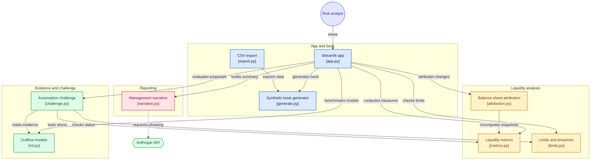

# Banking Liquidity Risk Lab

I built this to work through the second line's job on a bank's Banking book:
deposits, loans and undrawn commitments. Not the treasury desk that runs the
position, the independent function that has to say what moved and what it did
to liquidity, whether the book is inside its limits, and whether a proposed
change to a stress assumption is defensible. One synthetic bank, four tabs,
every number traceable.

Live: https://banking-liquidity-risk-lab.streamlit.app

All data is synthetic and seeded. No real institution, no real clients.

## The finding

In the second quarter of 2026 the bank runs an institutional cash program.
Deposits grow 3.3bn, loans grow 3.0bn, the balance sheet looks healthier,
and the LCR falls twelve points through the internal limit. Lending the new
money is most of it. The new deposits themselves add almost nothing, because
financial institution money carries a 100% runoff weight: a dollar in is a
dollar of HQLA and a dollar of assumed outflow. Had the same deposits been
held as cash the LCR would sit at 115%. That counterfactual is one line of
code and it is the whole argument a second line makes to the business.

A year earlier the same book went through a confidence event. The LCR barely
dipped while the bank burned a third of its HQLA, for the mirror-image reason:
the fastest money to leave carried the highest weight, so the ratio held while
the cash went. The internal survival horizon caught it, the ratio did not. The
ratio is a snapshot; the horizon is a cash flow. The limits tab watches both.

## The challenge

The first line proposes three changes to internal stress assumptions. Each is
tested against two witnesses, the worst 30 day outflow the segment has actually
produced and a model's reading of its history, with a 10% buffer on the
stronger one and a written rule. One is rejected because history has already
breached it, one is accepted with a re-test condition, one is counter-proposed
at the evidence floor. The memo is generated from the numbers.

The model is chosen by benchmark. On a time split trained before 2025, no
candidate called the confidence event at its onset: the largest call was about
a fifth of what followed. A model trained on calm history cannot see the first
severe event coming, and a tree model cannot predict an outflow larger than
any it has seen. That is why the model is a witness in the challenge and never
the assumption. The evidence model is then picked by fidelity, how closely it
reads each segment's own worst stress, and gradient boosting wins because a
linear model gives every segment the same stress slope.

## What it covers

How the modules fit together (each box is one file):

| Responsibility | Where |
|---|---|
| Identify and monitor liquidity risk on deposits, loans and undrawn commitments | data/generate.py, src/metrics.py, tab 1 |
| Analyze balance sheet changes and their liquidity impact, one driver at a time | src/attribution.py, tab 1 |
| Internal stress scenario next to the regulatory LCR and NSFR, reconciled by segment | src/metrics.py, tab 3 |
| Independent challenge of proposed assumption changes, with a written rule and a memo | src/challenge.py, tab 4 |
| Limits and early warning indicators, breach log, escalation | src/limits.py, tab 2 |
| Plain language summary for senior management, number-checked | src/narrative.py, top of the app |
| Learned outflow and draw behavior, benchmarked, with its limits stated | src/ml.py, tab 4 |
| 46 tests including a headless run of the app through every widget | tests/ |

## Run it

    pip install -r requirements.txt
    streamlit run app.py
    python -m pytest tests/
    python -m data.export

Optional: set ANTHROPIC_API_KEY to let an LLM phrase the senior management
summary. Every number in its draft is checked against the computed facts and
a draft with an invented figure is discarded for the template, which is what
runs without a key.

Assumptions and sources are written up in [docs/assumptions.md](docs/assumptions.md).
Build decisions are in [notes.md](notes.md).
